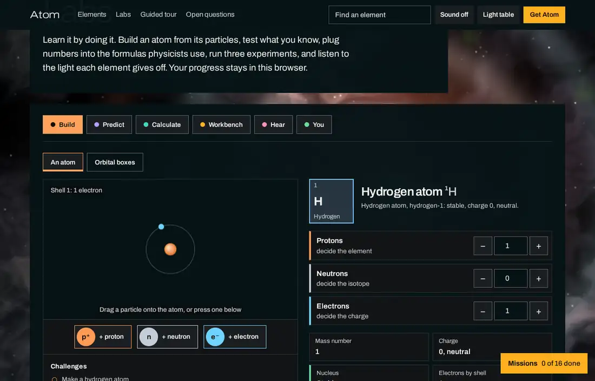
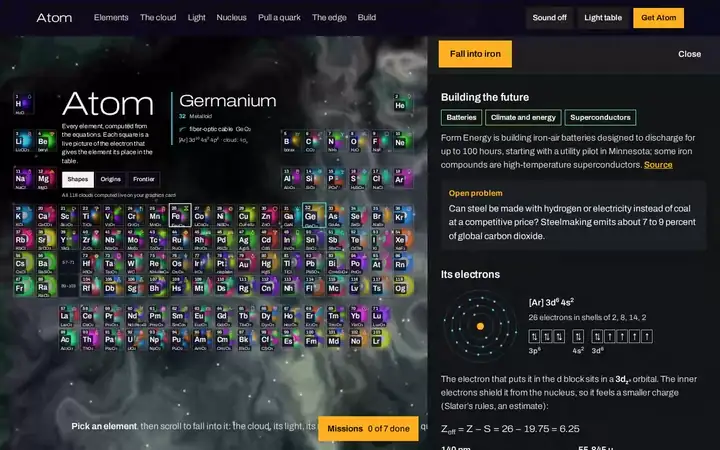
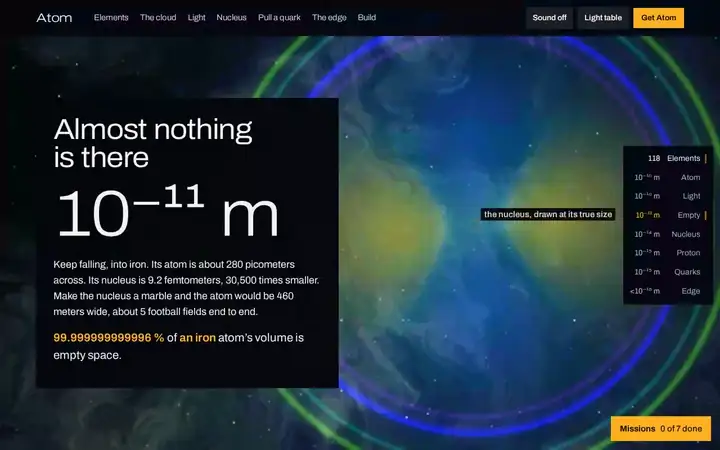
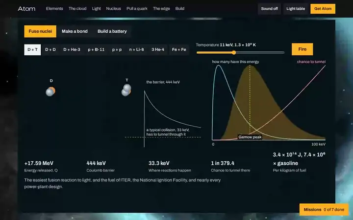

# Atom

**Every element, computed from the equations, set in the cosmos that made it. Pick one, build it from its particles, test yourself on it, hear its light, or fall into it all the way down to the quarks.**


Atom is a periodic table where every square is alive. Each one shows the electron that gives its element its place in the table, ray-marched in real time on your graphics processing unit (GPU) straight from the wavefunction. Behind the table is the place the elements came from: a nebula colored by the Big Bang, the stars, and the collisions that made them, which replays the birth of whatever element you pick. Click an element and you get its whole story, from where it was forged to the open problem it is part of today. Then do something with it: the labs let you build it from protons, neutrons, and electrons, answer questions about it, plug its numbers into the formulas physicists use, and hear its spectrum as a chord. Or scroll, and you fall into it: through its electron cloud, its light, the empty space inside it, its nucleus, one of its protons, and finally the quarks, where you can grab one and try to pull it out.

It runs as a website, as a desktop app for Mac, Windows, and Linux, or as a single HTML file you can open offline. It is free and open source. No accounts, no tracking, and the sound stays off unless you turn it on.

**[Open the website](https://normansrule.github.io/atom/)** · **[Download for Mac](https://github.com/normansrule/atom/releases/latest/download/Atom-mac.zip)** · **[Windows](https://github.com/normansrule/atom/releases/latest/download/Atom-Windows-Setup.exe)** · **[Linux](https://github.com/normansrule/atom/releases/latest/download/Atom-Linux.AppImage)** · **[Open the app in your browser](https://normansrule.github.io/atom/app/)**

## What's in it

**A table shaped by its orbitals.** Each square draws its element's *differentiating* electron, the one in the subshell its block is named for, in the orbital Hund's rule puts the last electron in. So the shape of the table and the shape of the clouds are the same fact: two columns of spheres (s), six of dumbbells (p), ten of cloverleaves (d), and fourteen of flowers (f). A full subshell is drawn round, because it is (Unsöld's theorem). When the page loads, the squares light up in order of atomic number as their clouds are computed, which is exactly the order electrons fill the table.

**A sky made of the elements' origins.** The background is never plain black or white. At the table it is a living nebula whose colors are the seven places elements come from: the Big Bang, cosmic rays, merging neutron stars, exploding massive stars, dying low-mass stars, exploding white dwarfs, and laboratories. Pick gold and a kilonova flares behind its square; pick carbon and a red giant swells. Fall into an atom and the sky becomes the element's own light, mixed from its measured spectral lines, with rings at the wavelengths it emits. Go into the proton and it becomes the flickering quantum vacuum.

**Four ways to read the table.** *Shapes* shows the orbitals. *Origins* gives every square a bar showing where that element was made, and you can pick a source to light up only its elements: every atom of gold you have touched came mostly from neutron stars colliding. *Frontier* marks what each element is helping build right now (fusion energy, quantum computing, batteries, chips, atomic clocks, superconductors, medicine, space, climate and energy, solar power, and magnets and motors), and you can pick a field to see which elements it depends on. Point at any square and the readout tells you what that element is doing at the frontier. *Yours* shows what you have made your own: a ring on every element you have explored, a half-filled dot on the ones you have built, and a solid dot on the ones you have mastered. To jump straight to an element, type its name, symbol, or atomic number in **Find an element**.


**Where you meet it.** Every square carries a small drawing of the thing you most likely know the element from (water, steel, batteries, toothpaste, smoke detectors) and its best-known compound: H₂O, Fe₂O₃, Li₂CO₃, SiO₂, and so on down to the superheavies, which honestly say "a few atoms at a time."

**A card for every element.** Click any square to open it:

- its electron configuration, a shell map, and the outer subshells drawn as boxes filled by Hund's rule, including the twenty elements that break the filling order and why
- Slater's effective nuclear charge, worked out with real numbers: Z<sub>eff</sub> = Z − S
- its nucleus: protons, neutrons, radius R = r₀A<sup>1/3</sup>, and the full semi-empirical mass formula (SEMF) with every term filled in, next to the measured binding energy and any magic numbers
- its visible spectrum: computed for hydrogen, and measured lines from the National Institute of Standards and Technology (NIST) for twenty other elements
- density, melting and boiling points, abundance in Earth's crust and in the universe, who found it and when, where it comes from, what it's used for, and one thing worth knowing
- **where it was made**, as shares of the Solar System's supply from each cosmic source
- **building the future**: what the element is doing at the frontier right now, with a link to the source, and an **open problem**, a question nobody has answered yet that someone reading could help answer
- **try it yourself**: build it, quiz yourself on it, or hear its light, with a line showing how far you have come with that element

**Labs: learn it by doing it.** Right under the table (and behind the **Labs** button in the app) are six labs. Each has its own color, so you always know where you are:

- **Build.** Put an atom together from its particles: click a proton, neutron, or electron, type the numbers, or drag a particle onto the atom. It names what you made (element, isotope, and ion), draws its nucleus and shells, and tells you whether the nucleus lasts, which way it decays if it doesn't, and when it falls apart at once. The lightest nuclei use measured limits, so oxygen stops holding together after oxygen-24, as experiments find; the rest are estimates and say so. An ion shows its own electrons, so iron(II) is [Ar] 3d⁶, not iron's neutral 4s². Eight challenges, from a hydrogen atom to the edge of the nuclear map, give you something to aim for, and **Share this atom** gives you a link that opens the same atom for someone else. Switch to **Orbital boxes** to place an element's electrons by hand, one arrow at a time, and check them against the three rules: lowest energy first, two to a box, and spread out before pairing up (including the exceptions, such as chromium and copper).
- **Predict.** A question, your answer, then the reason. Fifteen kinds of questions: neutrons, charge, atomic numbers, atom size, configurations you type in or name, stable or radioactive, density, melting points, blocks, valence electrons, the ions elements form, where they were made, which was discovered first, and how common they are in Earth's crust. The ones you miss come back ten minutes later, then a day later, then less and less often as you keep getting them right. Three different right answers about one element and you have mastered it.
- **Challenges, for teachers and friends.** In Predict, choose the elements, how many questions, and which kinds, and Atom makes a challenge: a link, plus a short code such as `A1.k3j9.10.nqcsb.H-He-Li-C` that can be read aloud or typed into the desktop app. Everyone who opens it gets the same questions in the same order, then a score, a list of what they missed, and a page to print. Nothing is collected: the questions are rebuilt from the code itself.
- **Calculate.** Four calculators with real formulas: the light an electron gives off when it falls between levels (with its color and series), radioactive decay with presets from carbon-14 to uranium-238 and a Geiger counter you can listen to, E = mc² with comparisons from burning gasoline to antimatter, and the molar mass of any formula you type, hydrates included.
- **Workbench.** The three experiments: fuse nuclei, bond two protons with one electron, and build a battery.
- **Hear.** Each visible line in an element's spectrum becomes a tone exactly 40 octaves below the light itself, so red plays low, violet high, and every element has its own chord with the light's real proportions. Play its electrons filling their shells as a melody, or try **Guess by ear**: a mystery element's chord and four names to choose from. Nothing plays until you press a button.
- **You.** Today's element and its three small tasks, what you have explored, built, and mastered on a table of your own, the questions due for review, the days in a row you have explored, your challenge scores, and eighteen badges. **Print my progress** makes a one-page summary.



**The guided tour.** Scroll down and the square you picked grows until it fills the screen, and then each section is about *that* element:

| Depth | What you see |
| --- | --- |
| 10⁻¹⁰ m, the cloud | The element's orbital, then every one of its occupied orbitals, then all its electrons at once as a layered glow, with the radial probability for each subshell |
| Light | Hydrogen emits its Balmer lines one photon at a time, with the cloud sloshing between two states as it shines. Other elements light up their measured lines, with E = hc/λ for each |
| 10⁻¹² m, the emptiness | A zoom from the whole atom down to a nucleus tens of thousands of times smaller, with the real numbers for your element |
| 10⁻¹⁴ m, the nucleus | Its protons and neutrons packed at the right density, and where it sits on the binding-energy curve |
| 10⁻¹⁵ m, a proton | Where a proton's mass comes from: only about 1% is the quarks themselves |
| Quarks | Grab a quark and pull. The gluon string pulls back with a constant 14.7 tonnes. Stretch it past about 1.25 femtometers and it snaps, making a new quark and antiquark out of the vacuum: p → n + π⁺ |
| The edge | Eight questions physics hasn't answered, each labeled with where it stands: open, claim, unresolved, new, or settled |





**The workbench.** The Workbench lab runs three experiments with the same physics the rest of the app uses:

- **Fuse nuclei.** Pick a reaction (deuterium and tritium, proton and boron-11, three helium-4s into carbon, even iron and iron) and a plasma temperature, then fire. The energy released comes from measured nuclear masses, the Coulomb barrier from the nuclei's charges and sizes, and the chance to tunnel from Gamow's factor, so you can watch most reactions happen far below the top of the barrier.
- **Make a bond.** Slide two protons together around one electron and find the distance where the energy is lowest. The curve is the textbook model of the hydrogen molecular ion, H₂⁺, and the bench shows how far that simple model lands from the exact answer.
- **Build a battery.** Choose the electrodes, from graphite and lithium cobalt oxide to silicon, lithium iron phosphate, and sodium-ion, and watch the voltage and the energy per kilogram change, with the elements each choice depends on.



**Missions.** Sixteen short journeys tie it together, laid out as one route on a map, from your first atom to the clinic: build an atom, read the light, weigh a molecule, date a bone, light a star, forge gold, make a new element, make a molecule, pull a quark out, split the atom, fuel a fusion reactor, build a better battery, build a chip, build a qubit, keep perfect time, and fight cancer with atoms. Each step names one thing to do, and a **Show me** button does it for you. The map lights each stop you finish and draws how far you are through the ones you have started. Your progress stays on your own device.

**The desktop app** opens on the same table, in the same nebula, with the same lenses, labs, and missions, and goes deeper: every orbital of every element, the nuclear shell model, the four natural decay chains, a guided tour, a math panel, and the chamber you can zoom through with your trackpad. Missions follow you into the chamber and wait in the gap above the transition metals of its own small table. Scrolling out past the whole atom takes you back up to the table.

## Use it

- **On the web:** go to [normansrule.github.io/atom](https://normansrule.github.io/atom/). Add `?el=Au` (or any symbol) to the address to start with that element.
- **On a Mac:** download `Atom-mac.zip` from the [latest release](https://github.com/normansrule/atom/releases/latest), unzip it, and drag Atom to Applications. It runs on Apple silicon and Intel Macs with macOS 12 (Monterey) or later.
  - If a release says it is notarized by Apple, it simply opens.
  - If it isn't, macOS stops it the first time with a message that it can't check the app for malicious software. Choose **Done**, open **System Settings**, go to **Privacy & Security**, scroll down to the message about Atom, and choose **Open Anyway**, then enter your password. You only do this once. (On macOS 14 or earlier, right-clicking Atom and choosing **Open** works too.)
  - Each release lists the SHA-256 checksum of every file in `SHA256SUMS.txt`, so you can confirm your download is the one published: `shasum -a 256 ~/Downloads/Atom-mac.zip`.
- **On Windows 10 or 11:** download `Atom-Windows-Setup.exe` from the [latest release](https://github.com/normansrule/atom/releases/latest) and run it. By default it installs for your account only, with no administrator rights needed. Windows doesn't know the app yet, so SmartScreen may say it protected your PC: choose **More info**, then **Run anyway**. To skip installing, download `Atom-Windows-portable.zip`, unzip it, and run `Atom.exe`.
- **On Linux (64-bit):**
  - **Debian, Ubuntu, Mint, and their relatives:** download `Atom-Linux.deb` and install it with `sudo apt install ./Atom-Linux.deb`. Atom then appears in your applications menu.
  - **Any other distribution:** download `Atom-Linux.AppImage`, make it runnable with `chmod +x Atom-Linux.AppImage`, and open it. If your system can't mount it, run `./Atom-Linux.AppImage --appimage-extract-and-run` instead.
- **Anywhere else:** `app/atom.html` is the whole app in one file. Open it in any recent browser, online or off.

On the table, the arrow keys move between elements, Enter opens the card, and Escape closes it. In the labs, the arrow keys move between the six labs, and every control works from the keyboard. In the app, T switches between the dark chamber and the light table, G opens the guide, and M opens the math.

## Privacy

Atom collects nothing. It has no accounts, no analytics, no cookies, and makes no network requests: every page, picture, and number comes from the site or the app itself. The desktop apps load only their own bundled page and send every web link to your browser. Your theme, your missions, and your progress in the labs are saved only in your own browser or app. **Erase my progress** on the You lab clears the labs (it asks first); clearing your browser's site data erases everything. A shared link or challenge code carries only the atom or the questions in its own text; opening one sends nothing anywhere.

## Found a mistake?

Atom is meant to be right. If a fact is wrong, out of date, or misleading, please open a [science correction](https://github.com/normansrule/atom/issues/new/choose) with a source. Bugs go in a [bug report](https://github.com/normansrule/atom/issues/new/choose). See [CONTRIBUTING.md](CONTRIBUTING.md) for how the project fits together.

## Build it yourself

The website is plain HTML, CSS, and JavaScript with nothing to install or compile:

```sh
cd docs && python3 -m http.server 8000
# then open http://localhost:8000
```

The Mac app needs the Xcode command line tools (`xcode-select --install`):

```sh
mac/build-mac-app.sh
# builds dist/Atom.app (Apple silicon and Intel), dist/Atom-mac.zip, and its SHA-256 checksum
```

With an Apple Developer ID, the same script signs the app with the hardened runtime and has Apple notarize it; the comments at the top of `mac/build-mac-app.sh` show how.

The Windows and Linux apps are a small [Electron](https://www.electronjs.org) window around the same file, in `desktop/`. They need [Node.js](https://nodejs.org) 22 or later:

```sh
cd desktop
npm ci
node build.mjs win      # on Windows: desktop/dist/Atom-Windows-Setup.exe and Atom-Windows-portable.zip
node build.mjs linux    # on Linux:   desktop/dist/Atom-Linux.AppImage and Atom-Linux.deb
npm start               # or just run it
```

The page gets no Node.js, no preload bridge, and no permissions, runs in Chromium's sandbox, and cannot navigate anywhere but itself; the Electron fuses that would let someone run the app as plain Node.js or attach a debugger to it are switched off.

On GitHub, pushing a tag such as `v1.0.1` builds all three apps, starts the Windows and Linux builds to run their self-tests, and publishes one release with every download and a `SHA256SUMS.txt`. Every push is checked by the workflows in `.github/workflows`: the HTML is validated, every page is loaded under the same path GitHub Pages uses, the physics self-test runs, accessibility is checked with axe-core, the Mac app is compiled and launched on a real Mac, and the Windows and Linux apps are built and started.

`app/atom.html` is the single source of truth. The website's physics, element data, renderer, and table (`docs/assets/atom-*.js`) are cut out of it by `scripts/sync-from-lab.sh`, never retyped, so the site and the app can't drift apart.

## Project structure

```
atom/
├── app/
│   └── atom.html                the whole app in one file: physics, data, renderer, interface
├── docs/                        the website, served by GitHub Pages
│   ├── index.html
│   ├── app/index.html           the app, so it also runs in the browser
│   ├── assets/
│   │   ├── site.js              the scroll, the zoom, and the scene behind the page
│   │   ├── site.css
│   │   ├── atom-data.js         generated: constants, the 118 elements, configurations, nuclear formulas
│   │   ├── atom-engines.js      generated: the WebGL 2 orbital ray-marcher and the quark-string physics
│   │   ├── atom-ptable.js       generated: the living table, the card, the nebula, the labs, and the missions
│   │   ├── atom-labs.css        generated: the labs' styles, shared with the app
│   │   └── fonts/               Archivo, the one typeface, and its license (OFL.txt)
│   └── media/                   screenshots and the recordings in this README (animated WebP)
├── desktop/                     the Windows and Linux app: an Electron window around atom.html
│   ├── main.js                  the window, the menus, and the locked-down web settings
│   ├── build.mjs, prepare.mjs   package it with electron-builder
│   └── smoke-desktop.mjs        start the packaged app and run its self-test
├── mac/
│   ├── main.swift               a window around atom.html, with a normal Mac menu bar
│   ├── build-mac-app.sh
│   └── icon.png
├── scripts/
│   ├── sync-from-lab.sh         copies the app in and regenerates the site's generated files
│   ├── extract-site-data.js
│   └── smoke.mjs                loads every page the way GitHub Pages serves it and checks it
├── .github/                     the checks on every push, the release build, and the issue forms
├── VERSION                      the version the next release will carry
├── CHANGELOG.md
├── CONTRIBUTING.md
├── SECURITY.md
├── THIRD_PARTY_NOTICES.md       the Archivo typeface's license and the data sources
└── LICENSE
```

## Design

**One idea carries the whole thing: you can always zoom.** The table is the top of a single zoom that runs from the elements to the quarks. The square you pick becomes the cloud, the cloud gives way to the nucleus, the nucleus to a proton, and the proton to its quarks. The depth gauge on the right edge is that zoom, used as navigation.

**Color always means something.** In the labs, each lab has one color and keeps it everywhere it appears (Build orange, Predict violet, Calculate teal, Workbench amber, Hear pink, You green), protons are orange, neutrons gray, and electrons blue, and green, amber, and red mean right, careful, and wrong. On a cloud, color is the phase of the wave, so it turns faster for tightly bound electrons, just as the energy says it must. The thin outline around each square is its chemical family. In the sky behind the table, color is origin: each of the seven cosmic sources has its own hue, and the nebula is mixed from the sources of the element you picked. Inside the atom, the sky takes the color an eye would see from the element's measured spectral lines. Red, green, and blue appear on quarks as color charge and nowhere else. There are two themes: the dark *chamber*, a deep-space sky with amber as its only accent, and the *light table*, which prints the same pictures as negatives on a pale nebula.

**Built to keep you curious, and to bring you back.** Explore first: the table and the labs are the home page, and the guided tour is there when you want it. Every card ends with a question nobody has answered, every lens asks you to look at the same 118 squares a different way, and every mission ends somewhere real: a fusion company's fuel, a quantum computer's atoms, the clock that may catch the constants of nature drifting. Coming back pays off too: a new element every day with three small tasks, the questions you missed waiting for you at the right moment, a table of your own that fills in as you go, and badges for the milestones. Nothing nags, nothing is timed, and nothing leaves your device.

**Type that gets denser as you go down.** Everything is set in Archivo, a variable typeface with a width axis. Headings start wide and light up in the electron cloud and get narrower and heavier with every step down, until inside the proton they're as compressed as the quarks.

**Honest physics.** Hydrogen is the only atom whose equation can be solved exactly, so it's the only one whose spectrum is computed; everything else is measured and cited. The labs check their own arithmetic every time the app starts (molar masses, hydrogen's lines, which nuclei hold together), and when the Build lab is estimating rather than reporting a measurement, it says so. Approximations say they're approximations: Slater's screening rules, the liquid-drop mass formula, and the Y-shaped string fitted to lattice quantum chromodynamics (QCD). Anything nobody knows yet appears only as an open question, with its status.

**Fast on purpose.** The nebula is one full-screen shader that measures its own frame time and lowers its resolution when a machine is struggling. All 118 clouds are drawn by one WebGL context in one pass, each clipped to its own square, and repainted a slice at a time, with the slice sized by how fast your machine is drawing. Since R<sub>nl</sub>(r; Z) = Z<sup>3/2</sup> R<sub>nl</sub>(Zr; 1), about twenty radial tables cover every element. The title and introduction are plain HTML that paint before any script runs, and the scripts are deferred; in headless testing on a local server, the Largest Contentful Paint (LCP) landed around a tenth of a second.

**For everyone.** Every label sits on a small plate of the background color so it reads at 7:1 contrast or better over the brightest cloud and the brightest part of the nebula, measured pixel by pixel in both themes of the app, across 66 views including every lens, every lab, the orbital boxes, a finished challenge, and the missions. When a lens filters the table, the squares it sets aside dim their clouds and keep readable labels. The table works with a keyboard alone. With reduced motion turned on, nothing zooms or scrubs: each section becomes a still, and every step is shown at once. Sound is always off until you ask for it.

## Sources

Constants are from the Committee on Data of the International Science Council (CODATA) 2022 values, quark masses from the Particle Data Group (PDG) 2026 review, spectral lines from the NIST Atomic Spectra Database, standard atomic weights from the International Union of Pure and Applied Chemistry (IUPAC) 2021 tables, and measured masses from the 2020 Atomic Mass Evaluation. Where each element was made follows Johnson's (2019) periodic table of nucleosynthesis, as a reconstruction rounded to about a tenth, and every frontier note links to its own source. The full list, in APA style, is at the bottom of the [website](https://normansrule.github.io/atom/) and in the app.

## License

MIT License. Made by Thomas J. Norman. The Archivo typeface is used under the SIL Open Font License; see [THIRD_PARTY_NOTICES.md](THIRD_PARTY_NOTICES.md).
